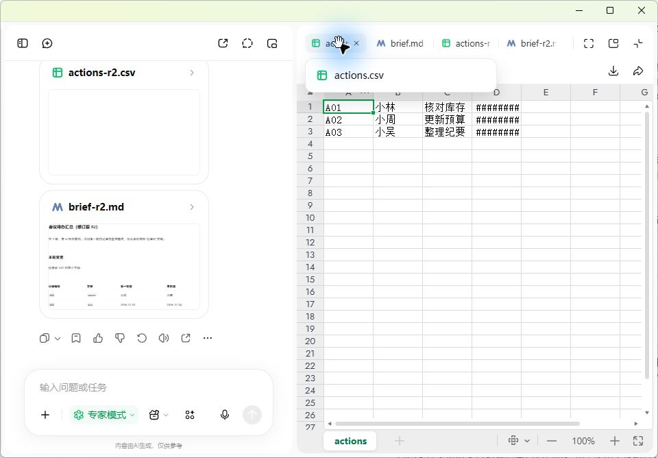
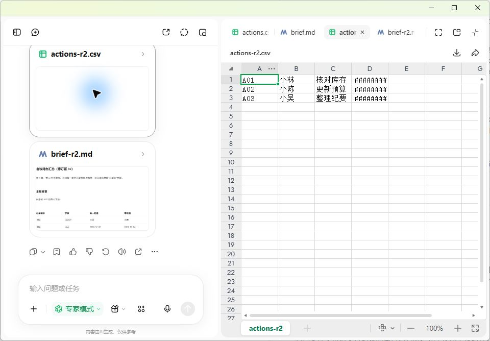

# 五款 Harness 办公任务竞品评测阶段报告
2026 年 11 月 20 日提交版

## 元宝案例：待办都提取对了，为什么交付仍然失败？

**结论。** 元宝专家模式在 T04 的失分点是最终 CSV 缺少表头。资料抽取和第二轮定点修改均正确。复查原会话后，能把缺陷定位到产品内可见产物，进一步排除“文件下载到本机时才丢掉表头”这一单独解释。

|同一次运行的证据|观察结果|诊断意义|
|---|---|---|
|用户题面、元宝回答|题面约定四列。第一轮回答称“校验通过”，列出 `id,owner,task,due`；第二轮也重申沿用这一列顺序。|可见回答掌握字段名称，但这项声明没有证明实际表头通过检查。|
|两轮文件卡的应用内预览|两张表的 A1 都是 `A01`，首行就是小林的任务；第二行的负责人由小周更新为小陈。|最早可直接核实的缺陷在预览阶段已存在，抽取与修改本身有成功证据。|
|两份下载原件|两轮均有三条正确记录，第一行都是 `A01,小林,核对库存,2026-12-01`。其余四款同题两轮均通过表头与数据检查。|按约定 E01 两轮失败。若下游把首行当列名，会失去第一条待办，或因找不到 owner 列拒绝导入。该影响是推演。|

**责任判定。** 文件格式不合格、交付流程没有拦住错误，两项现象置信高：预览和下载文件相互印证，且应用已向用户声明校验通过。最值得追查的是 Harness 在交付前如何核对用户要求与最终文件。现有证据看不到制表调用的输入及中间返回，故内部责任标为“模型／文件工具／Skill 未隔离”。如果生成阶段只给了三行数据，偏差在调用前就已出现；如果传给工具的参数明确要求写表头、工具返回的文件却从 A01 开始，则支持继续定位到工具执行或文件写出。界面展示的 A、B、C、D 是表格坐标，不能充当 CSV 的字段名。

**范围与下一次验证。** 两轮发生在一个会话，第二轮可能继承首轮格式。元宝在订单题两轮正确交付了带表头的 CSV，也通过了文件复制题的清单检查。这些反例限制了结论的范围。后续用正式独立会话复查同一断言，同时保留回答、预览和原件；只有取得工具调用边界的证据，才能进一步定责。[两轮下载原件](../runs/pilot-20261119/T04/yuanbao/)

## 正式订单题：元宝算对了金额，为什么仍漏一条异常？

五款产品第一次独立运行都完成了订单题的两轮交付。第一轮，五款的区域汇总和异常明细均正确。第二轮只统计华东，五款也都算对了 2 单、130.50 元。差距出现在**哪些原始记录被排除**：Codex、WorkBuddy、DSH、豆包工作的异常表均列出六条，元宝列出五条。对审核员而言，只看汇总金额会让这份少一行的明细通过验收。

订单 `o6` 有两个版本。旧版 rev.1 因重复被排除，新版 rev.2 在第一轮有效，第二轮因属于华南被排除。按题面，两行都保留原订单号，各有自己的排除原因。元宝写出了旧版的 `duplicate_older_revision`，漏了新版的 `out_of_scope`。它在第二轮报告中正确算出新版净额 120.00 元，又明确解释，同一订单号已经出现，因此没有再列一行。**能定位到的直接问题是把“每条原始记录只写首个原因”执行成了“每个订单号最多一行”。** 原件与产品自己的说明相符，结论对这次运行置信高。原因已经体现在产品报告中，单纯导出时丢行无法解释两份产物一致的结果。哪一层引入了这个规则解释、独立会话会多常复现，尚无受控证据。[元宝两轮原件与归因记录](../runs/formal-v1.1/evidence/T02-yuanbao-1/) · [冻结参考清单](../cases/T02/expected/exceptions-r2.csv)

**第二次独立重复。** 五款分别在新会话接收相同输入。元宝这次为旧版和新版 o6 各写一行，异常表六条齐全。两次第二轮中漏行一次、正确一次；这一结果支持“相同输入下的明细交付存在波动”，两次观察不足以估算产品长期出错率。WorkBuddy 本次在客户端显示首轮完成后才存档，两轮后原件哈希全部一致。[元宝第二次异常表](../runs/formal-v1.1/evidence/T02-yuanbao-2/round2/exceptions-r2.csv) · [WorkBuddy 第二次检查](../runs/formal-v1.1/evidence/T02-workbuddy-2/round2/checks.json)

| 产品 | 第一次运行 CSV 断言 | 第二次运行 CSV 断言 |
| --- | ---: | ---: |
| Codex | 4/4 | 4/4 |
| WorkBuddy | 4/4 | 4/4 |
| DSH | 4/4 | 4/4 |
| 元宝专家模式 | 3/4 | 4/4 |
| 豆包工作 | 4/4 | 4/4 |

每场四项来自两轮各一次汇总表和一次异常表核验。10 场共 39/40 项通过。此表只统计正式订单题中已核对的 CSV 内容；报告准确性、文件保留、输入保护及过程证据另按既定量表判断。元宝使用上传和下载，检查 JSON 中的哈希匹配只覆盖本地文件副本，云端旧件保留待独立核实。[十场分轮证据](../runs/formal-v1.1/evidence/)

## 正式订单题的原文件核查

订单题第二轮要求另存三份新文件。WorkBuddy 两轮四项 CSV 内容断言均通过。两份第一轮 CSV 在归档与复查间各减少三个字节，差异精确对应 UTF-8 BOM；订单金额、条数和异常原因一致。核查本机时间发现，第一轮归档清单写于 13:02:30，原名 CSV 最后修改于 13:02:31，第二轮两份 CSV 最后修改于 13:12:57。评测者过早采集了第一轮快照。字节差异可复核，但第一轮最终交付时的基线缺失，因此撤回 E07 失败判定，记为 unknown。两轮业务数据正确与文件版本保留是两个独立观察项。[WorkBuddy 核查记录及快照](../runs/formal-v1.1/evidence/T02-workbuddy-1/) · [DSH 第二轮检查](../runs/formal-v1.1/evidence/T02-dsh-1/round2/checks.json)

## 主要发现
在订单核对题中，Codex 和豆包工作都完成了本轮正式测试：按新政策汇总得到 4 单、450.50 元；限定华东后得到 2 单、130.50 元。两款均另存了第二轮文件，第一轮三份文件的 SHA-256 与变更前一致。在这两次运行的金额、异常归类和旧版保留上未观察到差距。[正式原件](../runs/formal-v1.1/evidence/)

更值得继续检验的差异出现在会议待办试跑中。元宝两轮都提取对三条待办，却交付了缺少表头的 CSV，按列名导入时可能需要人工补列名。WorkBuddy 的修订表正确，配套报告却把原负责人小周写成小林，影响追溯变更。原件直接支持这两项观察（高置信）；两轮属于同一会话，跨会话复现频率仍未知。[元宝原件](../runs/pilot-20261119/T04/yuanbao/) · [WorkBuddy 原件](../runs/pilot-20261119/T04/workbuddy/)

## 覆盖与评分
同一套合成输入覆盖订单核对、字节一致的文件复制、会议待办变更和损坏文件恢复。每题新开会话，需求变更留在原会话。按照逐项断言核验实际文件，过程无证据记 unknown。校准试跑共 20 场；正式协议计划 60 场，本次更新五款均已完成订单题两次独立重复，共 10/60 场、20 个交互轮次。下表为校准试跑的自动断言通过数／已检查数。

|产品|订单核对|文件复制|会议待办|备用数据恢复|正式证据进度|
|---|---:|---:|---:|---:|---|
|Codex|4/4|3/3|2/2|1/1|订单两轮，4/4 项 CSV 检查通过|
|WorkBuddy|4/4|3/3|2/2|1/1|订单两轮，4/4 项 CSV 检查通过，E07 第一轮最终基线缺失，记 unknown|
|DSH|4/4|3/3|2/2|1/1|订单两轮，4/4 项 CSV 检查通过，第一轮三份原件哈希保持一致|
|元宝专家模式|4/4|3/3|0/2|1/1|正式订单题 3/4 项 CSV 断言通过，第二轮缺 o6 新版范围外记录|
|豆包工作|4/4|3/3|2/2|1/1|订单两轮，4/4 项 CSV 检查通过|

这些分母只覆盖自动断言。正式总分按四题等权、每题三次重复及原评分规则计算，当前矩阵不足以给出总分。恢复题五款都输出了正确的数量明细，四份报告把“两条记录”和“八件”并列且标签有歧义；正式题已明确要求分别填写。试跑评分保留原口径。[复评裁决](../runs/formal-v1.1/pilot-adjudication.md)

## 证据与责任边界
归档文件支持对交付结果的高置信判断。元宝使用上传附件，其余使用本地目录；各产品默认模型不同，豆包曾显示调用表格技能。现有材料无法单独归因给模型、技能或 Harness。桌面控制未能送达的任务记评测端阻塞。复评有 AI 辅助、与初评间隔不足 24 小时，个别路径显示了产品名，结论存在记忆偏倚。后续正式重复优先核对已出现的表头、跨文件一致性和恢复报告措辞差异，并保留全部样本。[冻结协议](../runs/formal-v1.1/freeze.md) · [试跑报告](pilot-20261119.md) · [评分方案](../docs/evaluation-plan-v1.md)
